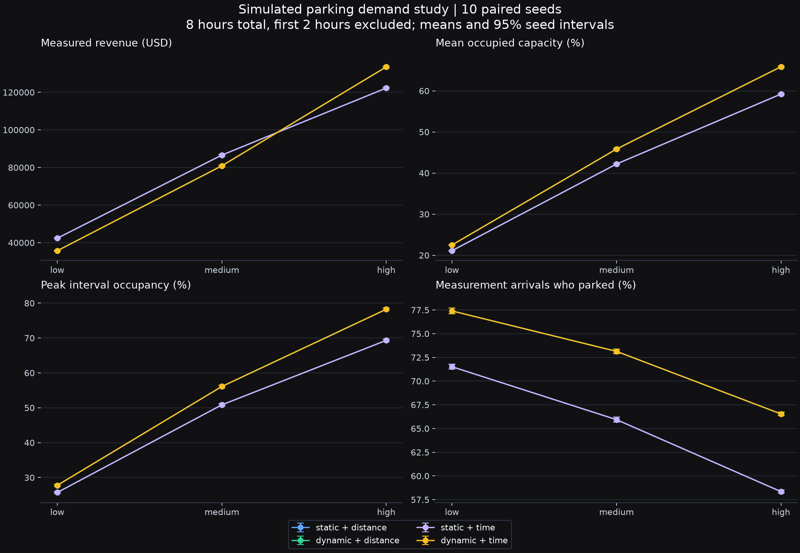

# Parking Optimization System

A parking policy research simulator developed for CIS 505 Algorithms Analysis and Design at the University of Michigan–Dearborn. It combines heuristic pricing, directed-graph routing, demand modeling, and simulated driver behavior.

## Overview

The simulator makes parking-policy assumptions explicit and compares their consequences:

- **Dynamic Pricing**: Occupancy and competition pricing heuristics
- **Smart Routing**: NetworkX shortest paths on directed road networks
- **Demand Prediction**: Deterministic, capacity-normalized historical arrival tables
- **City Coordination**: Distributed optimization using divide-and-conquer
- **Driver Psychology**: Behavioral modeling with 6 personality types

## Quick Start

Use Python 3.13 for the pinned development environment. With mise installed, `mise exec --` selects the repository's runtime.

```bash
mise exec -- python -m venv .venv
uv pip sync --python .venv/bin/python requirements-dev.txt
uv pip install --python .venv/bin/python --no-deps -e .

# A short offline run: no map download or provider calls
.venv/bin/parking-optimize --mode demo

# Replay a synthetic scenario with an explicit clock and seed
.venv/bin/parking-optimize --mode simulate --data-source synthetic \
  --zones 20 --drivers 100 --duration 2 --time-step 5 \
  --seed 42 --start-time 2026-11-12T08:00:00 \
  --skip-analysis --skip-visualizations --output output/scenario.json

# Generate charts from a saved run
.venv/bin/parking-optimize --mode visualize --input output/scenario.json

# Run offline tests and style checks
.venv/bin/python -m pytest --benchmark-disable
.venv/bin/ruff check .
.venv/bin/ruff format --check .
```

`--data-source auto` attempts the local map dataset and falls back to a connected synthetic grid. `--data-source map` requires the dataset; `--zones` controls synthetic scenarios, while map scenarios use every loaded zone. A demo omits analysis and charts for a quick run. Simulation mode generates them unless the skip flags are provided.

Each run saves results and metadata under `output/runs/` and updates `output/latest`. `--output` saves an additional JSON copy. Results record the effective data source, seed, simulation clock, interval lengths, and actual per-zone occupancy. Synthetic runs with the same seed, start time, and parameters reproduce their driver behavior and metrics. Live provider data is external and can vary.

Runtime map files, run folders, and the latest-run link are ignored by Git. Existing local files remain available. On a fresh checkout, use `make fetch-data` to download the optional Grand Rapids dataset before requesting `--data-source map`; synthetic demos need no download.

Refresh the Python 3.13 dependency pins deliberately with `uv pip compile pyproject.toml --extra dev --output-file requirements-dev.txt`. The Conda environment remains an alternative setup; its minimum version ranges do not reproduce the pinned environment. CI checks the pinned Python 3.13 environment; package metadata and tool targets now require Python 3.13 or newer.

## Controlled policy experiments

```bash
# Four policies under identical scenario seeds; no provider calls
.venv/bin/parking-optimize --mode compare --data-source synthetic \
  --zones 8 --drivers 100 --duration 2 --time-step 5 \
  --seeds 1,2,3,4,5 --event event --demand-multiplier 1.5 \
  --min-price 1 --max-price 8 --max-price-change 0.10

# Configure scenarios and compare policies in a local browser
.venv/bin/parking-optimize --mode dashboard --port 8765
# Open http://127.0.0.1:8765 ; Ctrl+C stops the server
```

Policies are `static-distance`, `dynamic-distance`, `static-time`, and `dynamic-time`. Distance policies use shortest driving paths; time policies use traffic-weighted paths. All use the same destination-aware driver behavior and constraints, with separate per-driver decision random streams. Use `--policies static-distance,dynamic-distance` to isolate pricing. The first selected policy is the baseline. `--seeds` requires at least two distinct integers. Comparisons default to synthetic data; `--data-source map` requires a valid local dataset and disables silent fallback. Live traffic is excluded from controlled comparisons.

Each CLI comparison saves `comparison/experiment.json`, `comparison/report.md`, `comparison/seed_outcomes.csv`, and a raw results/log directory for every policy and seed within its run folder. Dashboard experiments save the same artifacts below the dashboard run’s `experiments/` directory. Each comparison also generates `policy_comparison.png` with revenue, occupancy, parking-success, and stay-cost means and confidence intervals. The local dashboard displays these plots and loads the latest saved comparison on startup, so existing results are visible without rerunning a scenario. `--output` copies the comparison JSON; its artifact paths remain relative to the original comparison folder. The comparison JSON records source-code hashes, package versions, scenario fingerprints, and raw-result hashes. Each raw simulation result records its local dataset file hashes under `data_validation`. Every policy in a seed must receive identical zone and driver inputs or the experiment fails.

Reports show revenue, time-weighted occupancy and posted prices, successful/rejected/unresolved drivers, quoted stay cost, estimated driving/walking, and the gap from the occupancy target. Means have 95% Student t confidence intervals across independent seeds; policy effects use paired differences on the same seeds. A paired interval containing zero is inconclusive for that metric. Small seed counts are exploratory, and these intervals omit model uncertainty. Conditional means can describe different successful-driver populations, so the reports retain counts and sample sizes. Evaluate revenue, availability and affordability together.

Single simulations support `--pricing-policy static|dynamic`, `--routing-policy distance|time`, `--event normal|event`, `--demand-multiplier`, and the same price constraints. The fixed default simulation start is `2026-11-12T08:00:00`; use `--start-time` to change it.

Map loading checks explicit CRS, valid geometries, latitude/longitude, edge lengths, positive integer capacity and nonnegative USD rates. Non-WGS84 parking geometries are reprojected. Polygon capacity estimates use local metric area. Missing capacities/rates and assumed hourly units are flagged in `data_validation`, with per-zone sources; rates below $1 are never guessed to be per-minute. File hashes identify local inputs, but original publisher/retrieval provenance remains unverified unless supplied separately.

`make ci` runs lint, formatting verification, scoped Bandit, tests and wheel build. `make quality` additionally runs the existing strict Mypy audit, which still has legacy errors and is not a CI gate. The dashboard binds to loopback only, validates request origin and bounds the size of an interactive experiment. No deployment is required.

## Capacity-scaled demand study and Apple GPU

```bash
# Optional pinned Apple silicon environment (NumPy remains the portable baseline)
uv pip sync --python .venv/bin/python requirements-apple.txt
uv pip install --python .venv/bin/python --no-deps -e .

# 60 runs: three demand levels, five seeds, four policies; local maps, no provider calls
.venv/bin/parking-optimize --mode study --data-source map \
  --duration 8 --warmup 2 --time-step 5 --seeds 11,12,13,14,15 \
  --array-backend mlx --workers 4
```

The study sizes arrivals independently of parking policy from the loaded capacity and the current driver mix's expected stay of 190.75 minutes. Low, medium and high offered loads are 0.35, 0.75 and 1.15: arrival rate × expected stay ÷ capacity. These are input-demand ratios, not achieved occupancy targets. Steady arrivals span the entire simulation. All pricing and traffic updates also run during warm-up. Revenue and occupancy summaries exclude the warm-up, while parking outcome counts and conditional driver means describe drivers arriving after warm-up; late unresolved arrivals stay in the denominator. Warm-up must end on a simulation-step boundary and be shorter than the total duration. Two warm-up hours do not establish steady state for every long-stay commuter.

Each study saves `demand_study.md`, `demand_study.json` and `demand_study.png`. Full low and medium experiments are in `low/` and `medium/`; the high-demand experiment is in `comparison/`, so the local dashboard can load it. Each raw result records the actual capacity, generated drivers, driver arrival/parking observations and compute backend. Worker wall times are in separate `performance.json` files and do not change deterministic simulation hashes.

`--array-backend numpy` uses CPU array operations. `mlx` requires the optional MLX Metal backend and fails clearly when unavailable. `auto` selects MLX for at least 100,000 driver–zone pairs when Metal is available, otherwise NumPy. MLX batches the driver-to-zone walking-distance matrix in float32, with centered coordinates to retain local geographic precision. Evaluation, synchronization and conversion back to NumPy complete before decisions use the matrix. Graph searches and driver decisions remain on the CPU. Cached road-node lookups and routes avoid repeated work; time-weighted paths are invalidated when traffic is updated or expires. Parallel workers run independent policy/seed jobs in separate output directories.

The local benchmark at `output/runs/gpu-backend-benchmark/benchmark.json` includes coordinate conversion, GPU dispatch/evaluation/synchronization and the result transfer. Its speedup applies only to the batch-distance calculation, not the complete simulation. It is a measured local artifact and is not distributed as a performance guarantee.

## Project Structure

```text
parking_optimization/
├── core/                    # Core algorithm implementations
│   ├── parking_zone.py      # Zone management and occupancy
│   ├── dynamic_pricing.py   # Bounded snapshot-based pricing heuristics
│   ├── route_optimizer.py   # Directed shortest paths with expiring traffic weights
│   ├── demand_predictor.py  # Capacity-aware arrival forecasts
│   ├── coordinator.py       # City-wide coordination algorithms
│   ├── traffic_manager.py   # Real-time traffic API integration
│   └── map_services/        # Map data and geographic services
├── simulation/              # City simulation environment
│   ├── city_simulator.py    # Main simulation engine
│   ├── driver_behavior.py   # Psychological driver modeling
│   ├── experiments.py       # Paired-seed comparisons and decision reports
│   └── dashboard.py         # Local scenario controls and exports
├── analysis/                # Performance analysis and visualization
│   ├── visualizer.py        # Chart generation and dashboards
│   └── complexity_analysis.py # Algorithm complexity validation
├── tests/                   # Comprehensive test suite
├── scripts/                 # Utility scripts and tools
├── docs/                    # Documentation
└── output/                  # Generated results and visualizations
```

## Features

### Core Algorithms

- **Dynamic Pricing**: O(z²) zone comparisons with heuristic price adjustments
- **Route Optimization**: Weighted shortest paths; distance and travel time use the selected road edge
- **Demand Prediction**: O(t × s²) dynamic programming forecasting
- **City Coordination**: O(z²/d + d²) divide-and-conquer optimization

### Real-World Integration

- Google Maps API integration for traffic data
- Fallback mode works completely offline
- Grand Rapids, MI geographic data for demonstration scenarios

### Driver Psychology

Six assumed driver personality types:

- Optimizer, Satisficer, Risk-averse, Risk-seeking, Habitual, Social

## Available Commands

```bash
# Execution
make run              # Run the seeded offline demo
make simulate         # Run city simulation
make report           # Generate analysis and visualization report

# Testing
make test             # Run all tests
make test-coverage    # Run tests with coverage

# Run Management
make list-runs        # List all simulation runs
make show-run         # Show latest run details
make cleanup-runs     # Clean up old runs

# Setup & Maintenance
make setup            # Create the mise-managed runtime and sync pinned dependencies
make deps             # Restore the pinned dependency set
make clean            # Clean temporary files
make help             # Show all commands
```

## Evidence and limits

The [published evaluation](docs/evaluation/README.md) compares static and dynamic pricing at three capacity-scaled demand levels, with the routing policy held constant for pricing effects. It contains seed-level outcomes, paired confidence intervals, input/source hashes, and downloadable figures. Five original seeds and ten fresh validation seeds are reported separately. The [public report](https://jeremy-cleland.github.io/parking_optimization/) presents the same evidence.



Revenue accrues for occupied minutes at each driver's accepted entry rate, clipped at scheduled departure and simulation end. Later posted prices affect new arrivals. Measurement excludes the first two hours of each eight-hour run. Success rates retain unresolved measurement-window arrivals in the denominator. Quoted stay cost describes successful drivers and is subject to selection effects.

The evidence supports scoped conclusions within this model. It does not establish municipal revenue uplift, reduced congestion, forecasting accuracy on field data, latency guarantees, or concurrent-user capacity. Driver behavior and demand are uncalibrated. Many capacities and rates are assumed; dataset publisher and retrieval provenance are incomplete. The small, disconnected road extract limits routing comparisons. Search delays occur on five-minute boundaries, so these experiments cannot substantiate a search-time reduction.

Forecast evaluation uses an 80/20 chronological holdout of synthetic history. Event scenarios concentrate arrivals in the first quarter and apply a corresponding forecast factor. These scores describe synthetic consistency rather than field forecasting skill. Traffic is seeded simulation by default, including with local maps; provider observations remain an unvalidated optional integration.

The older files in `showcase/latest_run/` are retained as historical coursework artifacts. Use the dated evaluation for current policy claims and charts.

## API Configuration (Optional)

Synthetic mode and controlled comparisons run offline without API keys. Single simulations use simulated traffic by default; `--traffic-source live` enables a configured provider while geographic files remain local. Supported adapters are TomTom, Google Maps, and MapQuest. Comparable traffic/base duration responses update directed edge weights as labeled route-duration proxies and expire after five minutes. Provider access and fees depend on the provider's terms; live behavior has not been validated end to end.

```bash
export TOMTOM_API_KEY="your_key_here"
export MAPQUEST_API_KEY="your_key_here"
export GOOGLE_MAPS_API_KEY="your_key_here"

# Optional: Choose provider (defaults to tomtom)
export MAP_PROVIDER="tomtom"  # or "mapquest" or "google"
```

See [docs/API_SETUP_GUIDE.md](docs/API_SETUP_GUIDE.md) for detailed setup instructions.

## Class

**Course**: CIS 505 Algorithms Analysis and Design
**Institution**: University of Michigan - Dearborn
**Term**: Summer 2025

This project demonstrates practical application of advanced algorithms in real-world urban planning scenarios, with exploratory complexity analysis and simulation experiments.

## Team

- **Jeremy Cleland**
- **Saif Khan**
- **Asem Zahran**

## Dependencies

- Python 3.13+
- NumPy, Pandas, SciPy for numerical computing
- Matplotlib, Seaborn for visualization
- Requests for API integration
- Pydantic v2 for data validation

Complete dependency list in `pyproject.toml` and `environment.yml`.

## License

MIT License - See LICENSE file for details.
