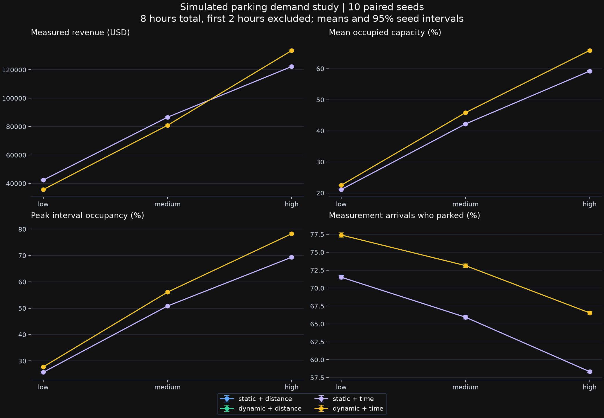
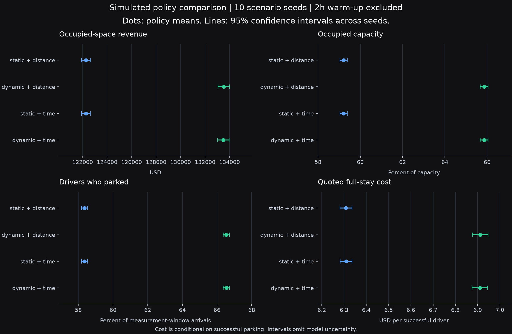

# Controlled parking policy evaluation · 12 November 2026

On ten fresh seeds at high demand, dynamic pricing increases modeled revenue by 9.2% and parking success by 8.2 percentage points versus static pricing with the same distance routing. Mean quoted stay cost rises from $6.31 to $6.91. Lower-demand scenarios improve access at a revenue cost.

This is a **simulation result**, not measured city revenue or a field experiment. Dynamic pricing is effective for the scoped high-demand revenue/access comparison. The lower-demand losses rule out a universal revenue claim. There is no evidence here of reduced congestion or search time.

## Design

- Original set: seeds 11–15. Fresh validation set: seeds 21–30, selected after the original study; the algorithm was frozen before both sets were rerun with entry-rate billing.
- Four policies per demand level: static/dynamic pricing × distance/time routing. Three demand levels, 180 total policy runs. Pricing effects below hold distance routing constant.
- Same generated driver and zone inputs within each seed, verified by scenario fingerprints. Independent decision and traffic random streams. Traffic is simulated.
- Eight hours total, first two hours excluded, six measured hours; five-minute steps. A two-hour warm-up does not establish steady state for every long stay.
- Revenue accrues for occupied minutes at the accepted entry rate. Prices later posted to new arrivals do not change an accepted stay's rate. Revenue includes warm-up arrivals still parked during measurement and is censored at simulation end.
- Driver outcomes use arrivals after warm-up, retaining unresolved late arrivals. Costs, walks, drives, and searches are conditional on successful parking and may describe different driver populations under different policies.
- 113 modeled zones, 17,472 spaces. Offered loads 0.35, 0.75, 1.15 generate 15,389 / 32,975 / 50,562 arrivals per run. Offered load is arrival rate × expected stay (190.75 minutes) / capacity, not achieved occupancy.
- Bounded prices USD 1–10/hour, occupancy target 85%, at most 15% posted-price movement per update. These are modeling choices, not a calibrated optimum.

## Pricing results

Figures below use static-distance and dynamic-distance; all four policies and every metric remain in the [JSON](evidence.json) and [seed CSV](seed_outcomes.csv).

| Set | Demand | Revenue: static → dynamic | Relative change of means | Paired revenue effect, 95% CI | Parked / measured arrivals | Mean quoted stay cost |
|---|---|---:|---:|---:|---:|---:|
| original | low | $42,326 → $35,533 | -16.0% | $-6,885 to $-6,701 | 71.8% → 77.4% | $6.17 → $4.87 |
| original | medium | $86,664 → $80,564 | -7.0% | $-6,475 to $-5,726 | 66.3% → 73.2% | $6.24 → $5.61 |
| original | high | $122,607 → $133,255 | +8.7% | $+10,202 to $+11,095 | 58.7% → 66.8% | $6.27 → $6.86 |
| validation | low | $42,386 → $35,722 | -15.7% | $-6,804 to $-6,523 | 71.5% → 77.4% | $6.20 → $4.91 |
| validation | medium | $86,589 → $80,870 | -6.6% | $-5,930 to $-5,508 | 65.9% → 73.1% | $6.28 → $5.66 |
| validation | high | $122,263 → $133,526 | +9.2% | $+10,982 to $+11,545 | 58.3% → 66.5% | $6.31 → $6.91 |

On the fresh high-demand seeds, the paired revenue effect is **USD 10,982 to 11,545** and the success-rate effect is **8.09 to 8.29 percentage points** (95% Student t intervals). Relative revenue percentages above are ratios of means, not confidence bounds. Intervals capture random-seed variation only; they do not include model, data, or parameter uncertainty. Metrics are exploratory and intervals are not adjusted for multiple comparisons.





## Reproduce and inspect

Set up the pinned Python environment from the [README](../../README.md). Run both studies with the same local map snapshot:

```bash
.venv/bin/parking-optimize --mode study --data-source map \
  --duration 8 --warmup 2 --time-step 5 --seeds 11,12,13,14,15 \
  --array-backend mlx --workers 4
.venv/bin/parking-optimize --mode study --data-source map \
  --duration 8 --warmup 2 --time-step 5 --seeds 21,22,23,24,25,26,27,28,29,30 \
  --array-backend mlx --workers 4
.venv/bin/python -m scripts.export_evaluation ORIGINAL_RUN_FOLDER VALIDATION_RUN_FOLDER
.venv/bin/python -m scripts.export_evaluation --verify
```

Use `--array-backend numpy` on other platforms. NumPy/MLX walking-distance parity is tested, but floating-point decision ties can differ. Synthetic runs require no map snapshot; replace `--data-source map` with `--data-source synthetic` to test the workflow, not to reproduce these geographic results.

The evidence JSON retains configurations, all seed outcomes, raw-result SHA-256 fingerprints, scenario fingerprints, package versions, per-experiment source hashes, and map validation/defaults/hashes. Raw driver files, logs and map files remain local and are not distributed. **Exact geographic reproduction requires the same map snapshot**; a fresh download can differ. Publisher/retrieval provenance is incomplete. Public verification recomputes aggregates from recorded seed outcomes and checks artifact hashes; it does not independently recreate the unarchived inputs.

## Limits and decision

Behavior, destinations, arrivals, and price responses are uncalibrated. Forty-four lot capacities use a `spots` field, five use metric-area estimates, and 64 meter-zone capacities default to eight; many rates default to USD 2/hour. The road extract has 58 nodes, 137 directed edges, and eight strongly connected components. Straight-line walks do not establish accessible pedestrian routes.

Traffic-weighted routing produces little separation on this extract. Successful search delay remains five minutes because of the model's step-based decisions; no search-time reduction is claimed. Synthetic forecast holdouts do not establish field accuracy. Optional MLX accelerates the walking-distance batch; graph and driver work remains on the CPU. No production latency or concurrent-user claim is supported.

The useful next step is field calibration and a larger connected road network, with a declared revenue/access/affordability objective. The current evidence supports using this as a policy experimentation tool, not adopting its prices as an operating policy.

CIS 505 team project: Jeremy Cleland, Saif Khan, and Asem Zahran, University of Michigan–Dearborn, Summer 2025.
